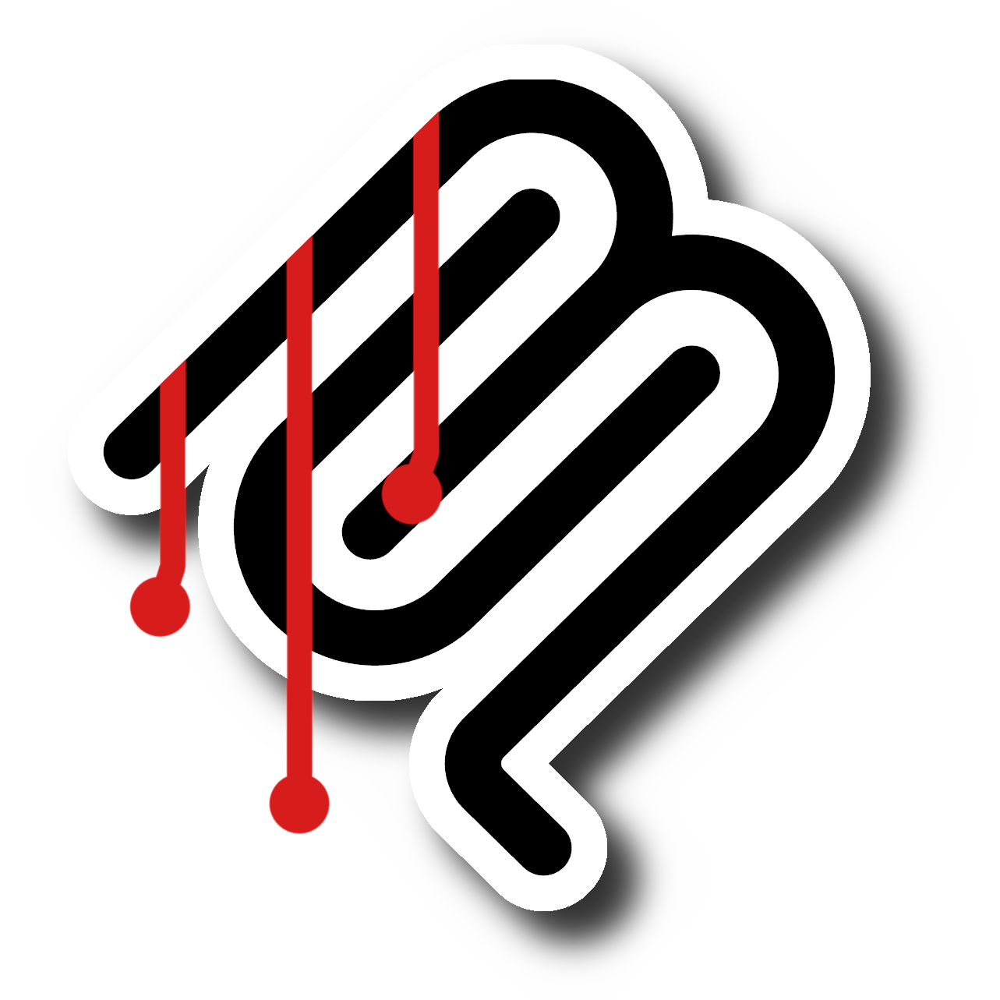
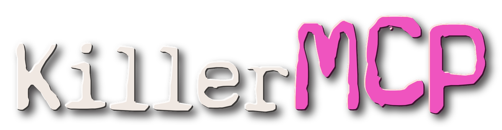

<p align="center">
  <a href="https://killertools.net/mcp"></a><br>
  <a href="https://killertools.net/mcp"></a>
</p>

One local MCP connection for KillerTools and the Killer app family: KillerPDF, KillerNotes, KillerScan, KillerShell, Killendar, KillerBench, and KillerShot.

KillerMCP detects the Killer apps you have installed, exposes the commands each version supports, and registers one MCP server with your agent clients.

## Install

[Download the signed installer](https://github.com/SteveTheKiller/KillerMCP/releases/latest/download/KillerMCP-Setup.exe), or install it with WinGet or Chocolatey:

```powershell
winget install killermcp
choco install killermcp
```

Setup registers KillerMCP with Codex, Claude Code, Claude Desktop, Cursor, GitHub Copilot, Gemini CLI, and Windsurf when it finds them. It needs the .NET 10 Desktop Runtime, which WinGet and Chocolatey install for you and the Microsoft Store version carries itself. Quit and reopen your agent client afterward, then start a new chat.

KillerMCP checks GitHub Releases hourly and can stay off, ask, download and ask, or install updates automatically. Every update must match its published SHA256 and pass Windows signature verification before it runs.

## What it includes

| App | Tools |
| --- | --- |
| KillerTools | All 81 website utilities from the native KillerTools engine |
| KillerPDF | Editing, conversion, inspection, OCR, printing, redaction and accessibility checks |
| KillerScan | Network details, scans, host probes, MAC vendor lookup, ping, route tracing, diagnostics and speed tests |
| KillerShell | Read-only file browsing, hashing, processes, services, event logs, registry and storage reports |
| KillerNotes | Search, read, create, edit, organize, tag, import images, history and export |
| Killendar | Agenda lookup and single appointments while the app is open and unlocked |
| KillerShot | Screenshots, MP4 and GIF recording, OCR, QR reading and image edits |
| KillerBench | Windows code lookups, diagnostic scans and guarded repairs that need UAC approval |
| Cross-app | Export notes, scan reports, agendas and folder listings to PDF, or save reports as notes |

Tools only appear when the installed app version advertises them. See [What KillerMCP can do](docs/CAPABILITIES.md) for the full tool guide, version requirements, limits, permissions and data handling.

## Build from source

```powershell
git clone --recurse-submodules https://github.com/SteveTheKiller/KillerMCP.git
cd KillerMCP
dotnet build KillerMCP.slnx -c Release
```

See [Architecture](docs/ARCHITECTURE.md) for the project layout, test suites and release process.

## License

KillerMCP is licensed under the [GNU General Public License Version 3](LICENSE).
